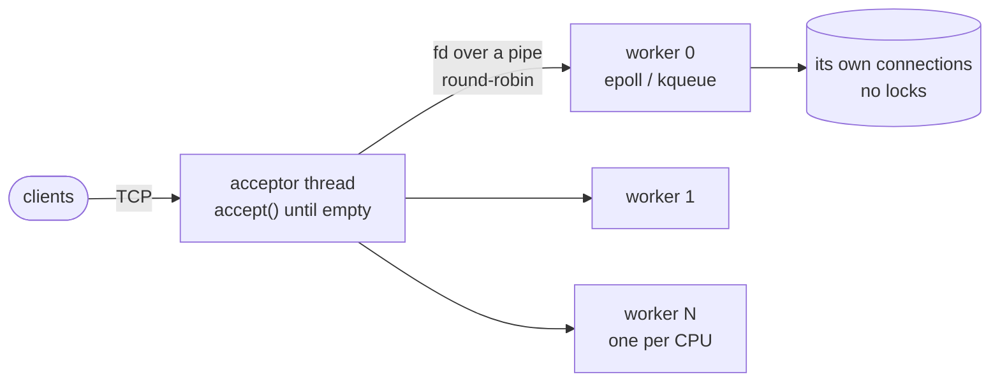
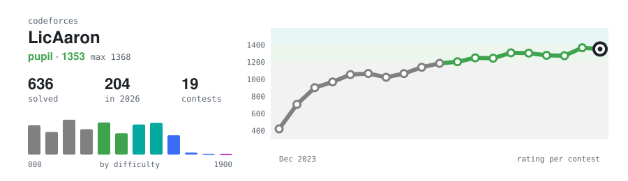

<picture>
  <source media="(prefers-color-scheme: dark)" srcset="./assets/header-dark.svg">
  
</picture>

<p align="center"><samp>
  <a href="https://portafoliohuron.netlify.app/">portfolio</a> ·
  <a href="https://www.linkedin.com/in/ugalde-tellez-aaron-b76567353">linkedin</a> ·
  <a href="mailto:aaronugaldet@gmail.com">aaronugaldet@gmail.com</a>
</samp></p>

Hi, I'm Aarón. I study AI Engineering at IPN–ESCOM in Mexico City, and most of what I build
ends up being the unglamorous middle of a system: the API, the schema, the pipeline that runs
every night, the evaluation that tells you whether the model actually got better.

This summer I interned on the Skills & Learning data science team at **Udemy**. I worked on
deduplicating a ~17,000-node skills taxonomy (bi-encoder retrieval, a fine-tuned cross-encoder,
Louvain clustering, then an LLM pass to merge and re-parent), built a two-judge LLM evaluation
with golden sets that showed a 16% precision gain over the old mapping, and moved the batch job
into Airflow so it runs over 85,000+ learning activities without anyone babysitting it.

Outside of that I compete in ICPC and teach at ESCOM's algorithms club and its AI club, GAIA.
I'm open to relocating.

### Things I've built

**[MetroAR-CDMX](https://github.com/AaronUgalde/MetroAR-CDMX)** · Kotlin, Jetpack Compose<br>
Point your phone around and see which way to walk to the nearest Metro, Metrobús or train
station in Mexico City. I wrote the AR math myself (Haversine bearings, projection with the
camera's real field of view, sensor smoothing that doesn't spin at 359° → 0°) and a pipeline
that turns the city's GTFS feed into an offline dataset of 1,000 stations across 36 lines.

<p>
  
  
  
</p>

<details>
<summary>The 12 Metro lines from the app's dataset, on a map you can drag around</summary>

```geojson
{"type":"FeatureCollection","features":[{"type":"Feature","properties":{"name":"Metro Línea 1","terminals":"Pantitlán - Observatorio"},"geometry":{"type":"LineString","coordinates":[[-99.2004,19.39828],[-99.18738,19.40205],[-99.18198,19.41295],[-99.17642,19.42075],[-99.17112,19.42185],[-99.16329,19.42365],[-99.1546,19.42566],[-99.14927,19.42674],[-99.14263,19.42733],[-99.13783,19.42639],[-99.13279,19.42515],[-99.12503,19.42549],[-99.12017,19.42915],[-99.11361,19.43122],[-99.1098,19.42685],[-99.10277,19.42336],[-99.09626,19.41994],[-99.09021,19.41648],[-99.08229,19.41192],[-99.0733,19.41552]]}},{"type":"Feature","properties":{"name":"Metro Línea 2","terminals":"Cuatro Caminos - Tasqueña"},"geometry":{"type":"LineString","coordinates":[[-99.21584,19.45959],[-99.20295,19.45864],[-99.1877,19.45881],[-99.1815,19.45725],[-99.17549,19.45291],[-99.17178,19.44927],[-99.16727,19.44456],[-99.16066,19.4419],[-99.15423,19.43923],[-99.147,19.43746],[-99.14101,19.4367],[-99.13687,19.43556],[-99.13225,19.4325],[-99.13279,19.42515],[-99.13454,19.41602],[-99.13445,19.4093],[-99.1369,19.40087],[-99.13781,19.39521],[-99.13896,19.38758],[-99.14002,19.38005],[-99.14157,19.36992],[-99.14226,19.3609],[-99.14501,19.35324],[-99.13953,19.34376]]}},{"type":"Feature","properties":{"name":"Metro Línea 3","terminals":"Indios verdes - Universidad"},"geometry":{"type":"LineString","coordinates":[[-99.11951,19.49534],[-99.1254,19.48429],[-99.13201,19.47719],[-99.13801,19.46927],[-99.14313,19.45506],[-99.14566,19.44494],[-99.147,19.43746],[-99.14768,19.43325],[-99.14927,19.42674],[-99.15036,19.41948],[-99.15325,19.41376],[-99.15559,19.40714],[-99.15603,19.39592],[-99.1572,19.38617],[-99.15948,19.37918],[-99.16505,19.37102],[-99.17086,19.36136],[-99.176,19.35346],[-99.18076,19.34625],[-99.17697,19.3361],[-99.17394,19.32435]]}},{"type":"Feature","properties":{"name":"Metro Línea 4","terminals":"Santa Anita - Martín Carrera"},"geometry":{"type":"LineString","coordinates":[[-99.12118,19.4035],[-99.12204,19.41001],[-99.12053,19.42159],[-99.12017,19.42915],[-99.11886,19.43942],[-99.11613,19.44895],[-99.11372,19.45658],[-99.11198,19.46463],[-99.10801,19.47436],[-99.10592,19.48399]]}},{"type":"Feature","properties":{"name":"Metro Línea 5","terminals":"Politécnico - Pantitlán"},"geometry":{"type":"LineString","coordinates":[[-99.14921,19.50068],[-99.14642,19.49019],[-99.14065,19.47907],[-99.13801,19.46927],[-99.13024,19.46311],[-99.11949,19.45887],[-99.11372,19.45658],[-99.1053,19.4514],[-99.09621,19.45126],[-99.08705,19.44535],[-99.08808,19.43427],[-99.08813,19.42435],[-99.0733,19.41552]]}},{"type":"Feature","properties":{"name":"Metro Línea 6","terminals":"El Rosario - Martín Carrera"},"geometry":{"type":"LineString","coordinates":[[-99.19994,19.50468],[-99.19602,19.4949],[-99.18627,19.49091],[-99.17415,19.49067],[-99.16299,19.48867],[-99.156,19.48985],[-99.14642,19.49019],[-99.13507,19.48811],[-99.1254,19.48429],[-99.11837,19.48174],[-99.10592,19.48399]]}},{"type":"Feature","properties":{"name":"Metro Línea 7","terminals":"El Rosario - Barranca del Muerto"},"geometry":{"type":"LineString","coordinates":[[-99.19994,19.50468],[-99.19535,19.49064],[-99.19004,19.47911],[-99.19051,19.46947],[-99.1877,19.45881],[-99.19177,19.44501],[-99.19093,19.43355],[-99.19203,19.42576],[-99.19135,19.41177],[-99.18738,19.40205],[-99.18581,19.39149],[-99.18661,19.38434],[-99.18716,19.37598],[-99.18926,19.3615]]}},{"type":"Feature","properties":{"name":"Metro Línea 8","terminals":"Garibaldi - Constitución de 1917"},"geometry":{"type":"LineString","coordinates":[[-99.13844,19.44394],[-99.14101,19.4367],[-99.14125,19.43158],[-99.14263,19.42733],[-99.14319,19.42155],[-99.14404,19.41324],[-99.13445,19.4093],[-99.12627,19.40671],[-99.12118,19.4035],[-99.11348,19.3983],[-99.11211,19.38829],[-99.10949,19.3791],[-99.1077,19.37321],[-99.10948,19.36484],[-99.10377,19.35441],[-99.09345,19.35783],[-99.08562,19.35605],[-99.07482,19.35106],[-99.0638,19.34597]]}},{"type":"Feature","properties":{"name":"Metro Línea 9","terminals":"Pantitlán - Tacubaya"},"geometry":{"type":"LineString","coordinates":[[-99.0733,19.41552],[-99.08239,19.40719],[-99.09125,19.40843],[-99.10316,19.40854],[-99.11297,19.40837],[-99.12204,19.41001],[-99.13445,19.4093],[-99.14463,19.40722],[-99.15559,19.40714],[-99.16852,19.40593],[-99.17892,19.40611],[-99.18738,19.40205]]}},{"type":"Feature","properties":{"name":"Metro Línea 12","terminals":"Tláhuac-Mixcoac"},"geometry":{"type":"LineString","coordinates":[[-99.18716,19.37598],[-99.17825,19.37355],[-99.17088,19.37201],[-99.16505,19.37102],[-99.15872,19.37066],[-99.15142,19.36134],[-99.14226,19.3609],[-99.12314,19.35776],[-99.10377,19.35441],[-99.10896,19.33685],[-99.10452,19.32815],[-99.09575,19.32215],[-99.08587,19.32047],[-99.07451,19.31761],[-99.06527,19.30631],[-99.05951,19.30432],[-99.04599,19.29996],[-99.03431,19.29666],[-99.02403,19.29435],[-99.0142,19.28602]]}},{"type":"Feature","properties":{"name":"Metro Línea A","terminals":"Pantitlán - La Paz"},"geometry":{"type":"LineString","coordinates":[[-99.0733,19.41552],[-99.06957,19.40462],[-99.05942,19.39876],[-99.04633,19.39128],[-99.03566,19.38515],[-99.01705,19.37331],[-99.00567,19.36472],[-98.99518,19.36031],[-98.97687,19.35904],[-98.96094,19.35056]]}},{"type":"Feature","properties":{"name":"Metro Línea B","terminals":"Ciudad Azteca - Buenavista"},"geometry":{"type":"LineString","coordinates":[[-99.15235,19.44619],[-99.14566,19.44494],[-99.13844,19.44394],[-99.13023,19.44322],[-99.12407,19.44279],[-99.11886,19.43942],[-99.11361,19.43122],[-99.10371,19.43657],[-99.0942,19.44084],[-99.08705,19.44535],[-99.07933,19.45101],[-99.06929,19.45809],[-99.06138,19.46167],[-99.05461,19.47289],[-99.04896,19.48575],[-99.04679,19.49069],[-99.04207,19.50149],[-99.03607,19.51513],[-99.03334,19.52135],[-99.03018,19.52848],[-99.02751,19.53451]]}},{"type":"Feature","properties":{"name":"ESCOM – IPN","note":"where I study"},"geometry":{"type":"Point","coordinates":[-99.14677,19.50466]}}]}
```

<sub>Generated from <a href="https://github.com/AaronUgalde/MetroAR-CDMX/blob/main/app/src/main/assets/stations.json">stations.json</a>. The pin is ESCOM.</sub>

</details>

**[reactor-http](https://github.com/AaronUgalde/reactor-http)** · C<br>
An HTTP/1.1 server in ~1,700 lines of C with no dependencies. Reactor pattern, one epoll/kqueue
loop per core, `sendfile` for static files. Holds 10,000 concurrent connections on my laptop and
passes its test suite under ASan/UBSan. The most fun bug was kqueue handing me a read and a
write event for the same connection in one batch, right after I'd freed it.

<details>
<summary>How it's put together</summary>



A connection belongs to one worker until it closes, so the hot path never takes a mutex.
Each turn a connection may send up to 256 KiB or serve 32 pipelined requests, then it yields
so one big download can't starve everyone else on that core.

</details>

**[cv-tailor-mcp](https://github.com/AaronUgalde/cv-tailor-mcp)** · Python · [PyPI](https://pypi.org/project/cv-tailor-mcp/)<br>
An MCP server that lets Claude Code or Cursor tailor a one-page LaTeX CV to a job posting.
It tries three spacing profiles until the PDF fits one page and turns `pdflatex` noise into
diagnostics an agent can act on. I wrote it because I was tired of doing that by hand.

**[credit-risk-modeling](https://github.com/AaronUgalde/credit-risk-modeling)** · Python, FastAPI<br>
Credit default model over 32k loan applications, taken past the notebook: custom scikit-learn
transformers, model selection by stratified CV (random forest, AUC 0.934), SHAP explanations per
request, and a FastAPI service with batch scoring.

**[hotel-perros](https://github.com/AaronUgalde/hotel-perros)** · TypeScript, PostgreSQL<br>
Management system for a dog hotel. 35-table schema, 100+ REST endpoints in a layered Express
backend, JWT auth with roles, and a React front end with a reservation calendar.

**[finetuning_t5_flant5_mt5_en2picto](https://github.com/AaronUgalde/finetuning_t5_flant5_mt5_en2picto)** + **[pictograms-annotator](https://github.com/AaronUgalde/pictograms-annotator)** · Python<br>
Translating sentences into ARASAAC pictograms for augmentative communication. I fine-tuned
T5, FLAN-T5 and mT5 for English → pictograms, then built a web app so a whole class can annotate
more training data.

**[esp32-cam-pet-bowl](https://github.com/AaronUgalde/esp32-cam-pet-bowl)** · C++, Python<br>
A patrol robot that checks on a pet's food bowl. ESP32 + Arduino over UART, a CNN on
ESP32-CAM frames, and a Telegram alert when something's off.

**[RAG-temarios](https://github.com/AaronUgalde/RAG-temarios)** · Python<br>
Ask questions about ESCOM's syllabi in plain Spanish. FAISS, MiniLM embeddings, Streamlit.

**[Competitive_Programming](https://github.com/AaronUgalde/Competitive_Programming)** · C++<br>
600+ accepted solutions from Codeforces, AtCoder and CSES, plus the template and stress tester
I bring to contests.

<a href="https://codeforces.com/profile/LicAaron">
  <picture>
    <source media="(prefers-color-scheme: dark)" srcset="./assets/codeforces-dark.svg">
    
  </picture>
</a>

### Lately

<!-- recent:start -->
- [pictograms-annotator](https://github.com/AaronUgalde/pictograms-annotator) <sub>Python · today</sub>
- [MetroAR-CDMX](https://github.com/AaronUgalde/MetroAR-CDMX) <sub>Kotlin · today</sub>
- [Proyecto-Paralelo](https://github.com/AaronUgalde/Proyecto-Paralelo) <sub>TeX · 4 days ago</sub>
- [reactor-http](https://github.com/AaronUgalde/reactor-http) <sub>C · 16 days ago</sub>
- [picto_xp3](https://github.com/AaronUgalde/picto_xp3) <sub>Python · 19 days ago</sub>
<!-- recent:end -->

<sub>This list and the Codeforces card are refreshed daily by <a href="./.github/workflows/update-readme.yml">a small workflow</a> in this repo.</sub>

<details>
<summary><sub>Tools I reach for</sub></summary>
<br>

Python, C++, TypeScript, SQL, Kotlin. FastAPI, Express, Next.js, React. PostgreSQL and PostGIS,
Docker, Airflow, Databricks, AWS SageMaker. PyTorch, Hugging Face, sentence-transformers,
scikit-learn, SHAP, FAISS, NetworkX.

</details>
