<picture>
  <source media="(prefers-color-scheme: dark)" srcset="./assets/header-dark.svg">
  <source media="(prefers-color-scheme: light)" srcset="./assets/header-light.svg">
  
</picture>

 

## 👋 Hi, I'm Aarón

**Software engineer** studying Artificial Intelligence Engineering at **IPN – ESCOM** (Mexico City).
I build backend services and the data infrastructure behind them — REST APIs, relational schemas,
scheduled pipelines — and I like the part where a prototype has to survive contact with production.

> [!NOTE]
> **Most recently:** Software / AI Products Engineering Intern at **Udemy** — shipped Airflow
> pipelines over **85,000+ learning activities** and ran jobs on **AWS SageMaker** with CloudWatch alerting.

- 🔭 **Now:** backend + distributed systems, and competitive programming in C++
- 🎓 **B.S. Artificial Intelligence Engineering**, expected July 2027 · GPA 8.83/10
- 🏆 **ICPC competitor** · instructor at ESCOM's Club de Algoritmia and GAIA (AI club)

## 🛠️ What I work with

<table>
  <tr>
    <td><b>Languages</b></td>
    <td></td>
    <td>SQL</td>
  </tr>
  <tr>
    <td><b>Backend</b></td>
    <td></td>
    <td>REST · Pydantic · JWT · SQLAlchemy</td>
  </tr>
  <tr>
    <td><b>Frontend</b></td>
    <td></td>
    <td>React 19</td>
  </tr>
  <tr>
    <td><b>Data &amp; infra</b></td>
    <td></td>
    <td>PostGIS · Apache Airflow · Databricks · SageMaker · CloudWatch</td>
  </tr>
  <tr>
    <td><b>Applied AI</b></td>
    <td></td>
    <td>Hugging Face · sentence-transformers · SHAP · NetworkX</td>
  </tr>
</table>

## 📌 Selected projects

<table>
  <tr>
    <th align="left">Project</th>
    <th align="left">What it is</th>
    <th align="left">Stack</th>
  </tr>
  <tr>
    <td><a href="https://github.com/AaronUgalde/hotel-perros"><b>🐕 Dog Hotel Management System</b></a></td>
    <td>Full-stack monorepo for a pet-boarding business: <b>35-table</b> PostgreSQL schema, <b>100+ REST endpoints</b> across 16 resource modules, JWT auth with role-based access.</td>
    <td><code>TypeScript</code> <code>Express</code> <code>React 19</code> <code>PostgreSQL</code></td>
  </tr>
  <tr>
    <td><a href="https://github.com/AaronUgalde/credit-risk-modeling"><b>📊 Credit Risk Modeling &amp; API</b></a></td>
    <td>ML system taken all the way to a serving layer: reproducible feature pipeline, model selection by 5-fold CV, FastAPI service with single + batch endpoints and <b>SHAP explanations</b>.</td>
    <td><code>Python</code> <code>FastAPI</code> <code>scikit-learn</code> <code>SHAP</code></td>
  </tr>
  <tr>
    <td><a href="https://github.com/AaronUgalde/Competitive_Programming"><b>⚔️ Competitive Programming</b></a></td>
    <td><b>600+ solved problems</b> across Codeforces, AtCoder and CSES, with the C++ template and stress-testing script I use in contests.</td>
    <td><code>C++</code> <code>Python</code></td>
  </tr>
</table>

## 💭 How I work

- I care about the boring parts: input validation, migrations, layered architecture, and knowing
  what a service does when it fails at 3am.
- I teach data structures and complexity analysis at ESCOM's algorithms club — explaining things
  is how I find out whether I actually understand them.
- Four national hackathons (Siemens, Interledger, IBM, SEDECO) — good practice at shipping
  something demoable in 48 hours and then being honest about what's still a prototype.

<b>📈 GitHub activity</b>

 

<picture>
  <source media="(prefers-color-scheme: dark)" srcset="./profile/stats-dark.svg">
  
</picture>
<picture>
  <source media="(prefers-color-scheme: dark)" srcset="./profile/top-langs-dark.svg">
  
</picture>

<picture>
  <source media="(prefers-color-scheme: dark)" srcset="./profile/snake-dark.svg">
  
</picture>

Cards are regenerated daily by a GitHub Action in this repo.

